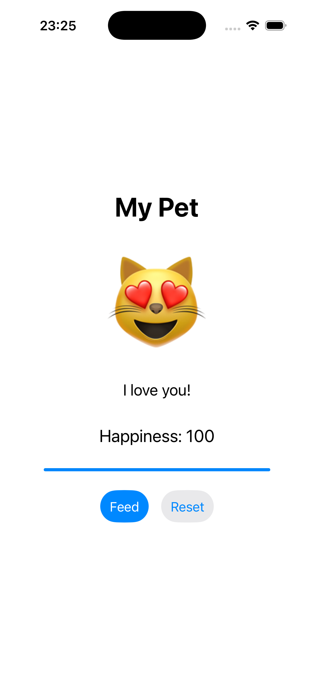

# TapPet

A small virtual pet app for iPhone, built with SwiftUI.

## Features
- Tap the pet to make it happy, with a bounce animation
- The pet's face and message change with its mood
- Happiness drops over time, using a timer
- Happiness is saved, so the pet remembers it after you close the app
- Happiness also drops while the app is closed

## What I learned
@State, @AppStorage, computed properties, Timer, scenePhase, and Git/GitHub

## Built with
Swift, SwiftUI, Xcode
